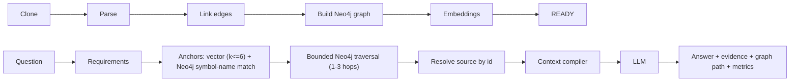

# CortexOS Architecture

This document describes the **implemented** system. It does not describe planned
or hypothetical components.

## System overview

```text
┌─────────────────────────┐     REST + SSE     ┌──────────────────────────────┐
│ CortexOS Studio (Next.js)│ ─────────────────▶ │ Runtime API (FastAPI)         │
│ chat · PR review · graph │                    │ routes · kernel · providers   │
└─────────────────────────┘                    └───────────────┬──────────────┘
                                                                │ SQLAlchemy (async)
        ┌───────────────────────────────────────────────────────┼──────────────┐
        │                                                        ▼              │
┌───────────────┐    claims jobs (SKIP LOCKED)      ┌────────────────────────┐  │
│ cortex-worker │ ◀───────────────────────────────▶ │ PostgreSQL + pgvector  │  │
│ ingestion     │                                   │ graph · embeddings ·   │  │
│ + benchmarks  │                                   │ executions · job queue │  │
└──────┬────────┘                                   └────────────────────────┘  │
       │ generation / embeddings                                                │
       ▼                                                                        │
┌───────────────┐                                                               │
│ Model provider│ ◀─────────────────────────────────── API (chat, impact) ──────┘
│ (Ollama)      │
└───────────────┘
```

**One database carries everything** — knowledge graph, embeddings, executions,
event stream, chat sessions, and the job queue. There is no external queue or
cache service.

## Components

### Knowledge Graph
The unit of knowledge is a **semantic artifact** — a structural unit
(module / class / function / method / doc section) with stable identity, source
span, extracted facts, and multiple representations. Artifacts are connected by
typed **edges** (`calls`, `imports`, `inherits`, `contains`, `references_doc`,
`documents`). Stored in `semantic_artifact` and `artifact_edge`. This graph is
language-agnostic, so every capability built on it (chat, architecture, impact,
insights) works across languages.

### Repository ingestion pipeline
`FETCH → ENUMERATE → PARSE → LINK → EMBED → BASELINE → FINALIZE`, run by the
worker as an idempotent, resumable job (every write is an upsert keyed on
`(source_version_id, …)`; the commit SHA is pinned on first run). Structural
parsing is deterministic — Python via the stdlib `ast`, JavaScript/TypeScript
(incl. JSX and `tsconfig`/`jsconfig` alias resolution) via a dependency-free
parser — so code facts are always grounded, never hallucinated. Source versions
are append-only; re-ingesting a commit supersedes the previous version and
invalidates stale Semantic-Virtual-Memory pages.

### Adaptive Context Compiler
Turns retrieved candidate artifacts into the **minimum sufficient context** for
a task: it selects representations (raw code vs. compressed facts), deduplicates,
and packs against a token budget derived from the task profile. It reports the
real reduction versus the raw candidate tokens.

### Inference Budget Controller
The deterministic core of CortexOS's efficiency contribution. Before any
optional, expensive operation it answers one question — *should this inference
happen, or can a cheaper deterministic path produce an equivalent result?* —
and records a typed `BudgetDecision`. **Rule: no LLM call ever decides whether
to make an LLM call.** Routing is a pure function of the task profile (fast path
for simple factual questions skips model-based requirement decomposition; deep
path keeps it), so the same question always takes the same, measurable path.

### Semantic Virtual Memory (SVM)
Treats the context window as managed working memory over a session. Artifacts
become **pages** that stay resident across turns of a conversation (stable,
append-only prefix), so the model runtime reuses its KV cache and later turns
only pay for new pages. Memory pressure triggers eviction; re-ingestion
invalidates pages. Scoped per chat session.

### Change Impact Guard (v2)
CortexOS's flagship task. A diff (pasted or fetched from a GitHub PR) becomes a
grounded impact report by reusing the kernel:

```text
diff ─parse─▶ changed artifacts ─reverse-BFS over dependency edges─▶ blast radius
     │                                                                    │
     ▼                                             deterministic reasoning ▼
  Context Compiler (changed + impacted) ─▶ ONE model call ─▶ narrative + report
```

The structural work is deterministic graph traversal (zero inference). Only the
human-readable narrative costs one model call. The report includes: risk level +
reasons, direct/indirect impact, **impact by engineering dimension**
(API / database / configuration / frontend / background-worker / external-service
/ auth / caching / architectural), **dependency-chain evidence** (why each
dependent is affected), **structured confidence** (each factor a measured graph
fact), recommended tests, suggested follow-ups, and — when a PR is re-analyzed —
a **revision comparison** (new/resolved risks, blast-radius delta, risk trend).

### Engineering Intelligence
Deterministic analyses over the same graph, no model calls:
- **Dead code** — functions/classes with no inbound dependency edge and not an entrypoint, with evidence.
- **Circular dependencies** — file-level cycle detection with risk + resolution.
- **Repository insights** — large modules, high-coupling files, hotspots (most-referenced), architecture-layer distribution.
- **Request-flow tracing** — forward traversal from an entrypoint through `calls`/`imports`.

### Model provider abstraction
The kernel talks to models only through `ModelProvider` (generate, embed,
streaming, health). Ollama is the default, local, zero-cost implementation;
the deployment target selects a provider by configuration. Nothing else in the
codebase depends on Ollama directly.

## Request lifecycle (a chat question)

1. `POST /v1/executions` inserts an execution row (`running`) and starts a
   background task; returns immediately.
2. Kernel: **Task Profiler** classifies the question → **Budget Controller**
   picks fast/deep path → **Requirement Generator** (model call only on deep
   path) → **Hybrid Retrieval** (vector + graph) → **Context Compiler** →
   **model generation** → **Sufficiency Evaluator** (one bounded expansion
   retry if under-grounded).
3. Every stage emits a typed event; Studio consumes them live via
   `GET /v1/executions/{id}/stream` (Server-Sent Events).
4. The final answer + measured metrics (tokens, reduction %, model calls,
   latency, budget decisions) are persisted on the execution row.

## Worker architecture
The database **is** the queue. Workers claim jobs with
`SELECT … FOR UPDATE SKIP LOCKED`, kind-filtered by lane
(`CORTEX_WORKER_KINDS`), so a long benchmark never blocks ingestion. Crashed
workers are recovered by lease expiry; cancellation is cooperative via
checkpoints; each worker heartbeats for health reporting. Graceful shutdown
disposes the connection pool.

## Data model (core tables)
`source` · `source_version` · `source_file` · `semantic_artifact` ·
`artifact_edge` · `artifact_embedding` · `baseline_chunk` · `execution` ·
`execution_event` · `chat_session` · `job` · `worker_heartbeat`. Managed by
Alembic migrations (`api/alembic/versions`, `0001` → `0005`).

## Knowledge Graph + Graph-RAG (Neo4j)

The graph is a projection of the semantic artifacts and typed edges ingestion
already writes to Postgres. Neo4j stores structure and pointers only (artifact
id, path, symbol name, kind, span) - never source text. Source is resolved from
Postgres by artifact id after traversal.



- **Schema**: `(:CxNode {key, vid, ...})` with labels `Repository`, `File`,
  `Module`, `Class`, `Function`, `Method`, `Doc`, `Config`. Relationships:
  `CONTAINS`, `DEFINES`, `IMPORTS`, `CALLS`, `EXTENDS`, `REFERENCES`,
  `DOCUMENTS`. Only relationships the parsers actually resolve exist
  (other types in the roadmap - IMPLEMENTS, READS, WRITES, TESTS, EXPOSES - are not extracted yet).
- **Isolation**: every node has `vid` (source version id) and every Cypher
  query filters on it; fetched artifacts are re-scoped by version in SQL.
- **Traversal**: one Cypher query per hop, hop depth `CORTEX_GRAPH_MAX_HOPS`
  (hard cap 3), per-hop node cap `CORTEX_GRAPH_HOP_LIMIT`. Questions about
  impact ("what is affected if I modify X") follow dependents (incoming edges).
- **Ingestion**: stage `building_graph` runs before embeddings. If Neo4j is
  configured and the build fails the job fails (retried) - a version is never
  READY without its graph. With `NEO4J_URI` empty the graph is recorded as
  `disabled`, retrieval falls back to Postgres hybrid, and the UI says so.
- **Metrics** (per question, `execution.metrics.graph_rag`): nodes explored,
  edges traversed, candidate/selected sources, files, question / query-understanding /
  context / answer / total model tokens, retrieval + graph + generation latency,
  and the reasoning path. Token reduction is always `not_benchmarked` here;
  a percentage exists only from a real baseline benchmark.
- **Setup**: `docker compose up neo4j` (Community Edition, free). Hosted:
  any Neo4j endpoint via `NEO4J_URI/USERNAME/PASSWORD/DATABASE` (e.g. AuraDB Free).
- **Backfill**: `POST /v1/sources/{version}/graph/rebuild` projects an already
  ingested version from Postgres into Neo4j (no re-clone); Studio offers it as
  a "Build knowledge graph" button when a repository has no graph.
- **Path quality**: test code is excluded from anchors and traversal unless the
  question mentions tests or asks about impact (tests are ranked last).
  Same-name call targets are narrowed by caller file and production-vs-test
  evidence at link time; still-ambiguous links carry confidence 0.5, are skipped
  in ordinary traversal and shown as "uncertain" for impact questions.
- **Languages**: Python (AST) and JS/TS (regex parser) get symbol-level nodes
  and call/import/inherit edges; Markdown gets sections; other files get a
  file/module node. `coverage` = share of code files parsed to symbols.
- **Security**: git token is sent only to `CORTEX_GIT_ALLOWED_HOSTS`; in
  production repositories must be credential-free https URLs on those hosts.
  Neo4j credentials are server-side only.
- **Answer cache**: `answer_cache` table (migration 0007), keyed by
  sha256(version id, normalized question, graph build stats, pipeline revision,
  models, hop/confidence settings). A hit creates a finished execution with the
  stored answer, metrics and event trail (`metrics.cache.hit`; figures are the
  original run's, and the UI says so). Not cached: baseline runs, failures,
  degraded-graph answers, "context did not contain it" answers. Entries expire
  after 30 days; `no_cache: true` on `POST /v1/executions` forces a fresh run.
  Session turns share the cache but a hit does not page context into the
  session's working memory.
- **Accounts**: `app_user` + `user_session` (migration 0008). Register/login
  (`cortex/accounts.py`) issue an opaque session token; a request's bearer
  token resolves to a configured service token or a login session, and the
  resulting user id is the `owner_id` used by the ownership guard below.
  Studio gates the whole app behind the sign-in screen and drops all
  repository state on sign-out.
- **Ownership**: `source.owner_id` (migration 0006). A router-level guard
  (`cortex/access.py`) 404s any `{version_id|execution_id|session_id|job_id|run_id}`
  not owned by the token's user; list endpoints and body-supplied ids are
  filtered/checked in the route. Identity is a bearer token from
  `CORTEX_API_TOKENS` - there is no password login or OAuth.
